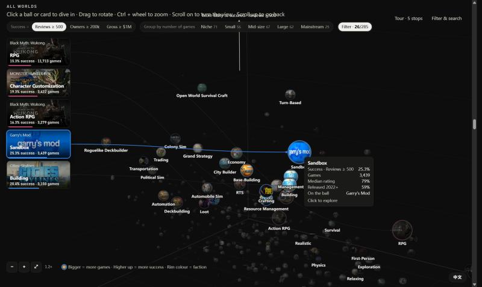

# Steam Galaxy Viz

An interactive, fully offline 3D map of Steam tags: which kinds of games get noticed, how crowded each lane is, and what the winners look like.

Every ball is a Steam tag wearing the covers of its games. Scroll to play a short story, pick a "world", explore the map, then keep scrolling for a guided rotation that walks through five findings and a summary.



**Open [`steam_tag_dashboard.html`](steam_tag_dashboard.html) in a modern browser.** It is one self-contained file (~30 MB, covers embedded as WebP). It needs no server and no network. WebGL2 is used when available, with a 2D canvas fallback.

English by default. Add `?lang=zh` for Chinese, or use the toggle in the corner.

> 中文简介：基于 FronkonGames/steam-games-dataset 的 Steam 标签三维星图，单个 HTML 文件，完全离线。每颗球是一个标签，球面是该标签的游戏封面。页面支持多种成功标准、小众→大众分组、精细筛选与聚焦、组 › 类别 › 游戏三级选中，以及逐步展开的数据长卷。右下角可切换中英文，也可以在网址后加 `?lang=zh`。

---

## What the map shows

| Channel | Meaning |
|---|---|
| Horizontal axis | Number of games carrying the tag (log scale), from niche to mainstream |
| Vertical axis | Success rate, judged against games released the same year by default (the simple count is one click away) |
| Depth | Share of the tag's games released in 2022 or later |
| Ball size | Number of games |
| Ball surface | Cover art of the tag's games. The ball starts on its best-known game and then rotates through its games, weighted by review count |
| Rim colour | Faction (a hand-curated family of tags, see `tag_families.csv`) |

Median rating sits on no axis on purpose. At the tag level it correlates −0.42 with success rate, so it would draw a misleading diagonal. It is shown in tooltips, cards and the detail panel instead.

### One definition of success, read two ways

Scope: tagged games released 2018–2024. A game succeeds when it reaches **500 Steam reviews**; the baseline is 9.8%.

| Reading | What it is |
|---|---|
| vs. same-year games (default; 和同年游戏比) | actual rate ÷ the rate expected from the tag's mix of release years × the baseline |
| Simple count (直接统计) | share of the tag's games with ≥ 500 reviews |

A 2018 game has had seven years to collect reviews and a 2024 game barely one: the yearly success rate of tagged games falls from 11.1% (2018) to 7.6% (2024). Tags full of recent games therefore look worse than they are. The adjustment (`scripts/derive.py`) removes release year and nothing else. Findings, badges, rankings and the summary all use the adjusted rate; the detail panel shows both, plus the expected rate.

### Blue and red oceans: one rule, judged among peers

The map badges, the detail-panel verdict, the tour, the summary and Studio's single-tag lanes all call one function, `classifyOceans` in `scripts/db.js`, on per-tag figures from the game table (`tagStats`). Each tag is compared only with the other tags of its faction (generic and outcome tags are not judged):

| Class | Rule |
|---|---|
| Blue-ocean candidate | share of 2022–24 releases in the faction's bottom quarter, its typical game at least median attention, and the **low end** of its 95% success range above the faction's upper quartile |
| Red-ocean risk | share of releases in the top quarter, typical game below median attention, and the **high end** of its 95% range below the faction median |
| Crowded but strong | top-quarter share, low end of the range above the median |
| Little attention | bottom-quarter share and below-median attention |
| Mixed / too few games | anything else; under 40 games or fewer than 8 comparable tags |

Success is the year-adjusted rate shown as "about X in 100", with its 95% range. Attention is the median, over the tag's games, of each game's review-count percentile among games released the same year. The map always judges by 500 reviews; Studio recomputes the classes for the success definition you pick and says when that differs from the map. `node scripts/backtest_oceans.js` sets the classes on 2018–20 releases and checks them on 2021–23, both read from today's snapshot (so it compares two release cohorts; it does not show the classes could have been picked at the end of 2020): all 4 early candidates stayed above their faction median (180 of 909 distinct games, 19.8%, reached 500 reviews) and 25 of 29 red-ocean risks fell below it. Red-ocean tags are broad (Casual, 2D, Puzzle …), so their games together succeed about as often as the market (2,499 of 26,845 = 9.3%, against 2,514 of 27,082 = 9.3% for all games released 2021–23): the class says a tag trails its own peers, not that its games are unusually unlikely to succeed. Moving the window one year or the quartile cut to 20% / 30% flips borderline tags, so read the classes as a first filter, not a verdict.

Earlier versions of the map offered owner- and gross-based definitions as well. They tracked the review definition closely (r = 0.84–0.88 across tags) on much coarser data, so they were removed; an upper-bound gross estimate (P90 and median) remains in the pricing chapter for reference. Studio still offers both (owners ≥ 200k, band top; estimated gross ≥ $1M) for its own views, labelled as such.

## How to use it

- **Scroll** to move through the story, the world select screen, and the map. Scrolling further rotates the view through the findings. Scrolling up peels back one layer at a time.
- **Axis titles** sit on the axes when they fit on screen. When you zoom in, select a tag or turn the view so that one no longer fits, it moves to a small key at the bottom-right of the map, with an arrow showing which way that axis currently runs.
- **Hover a ball.** Its card appears on the left, highlighted and linked to the ball by a line. Pause on a ball for a moment and its most frequent co-tags stay lit while the rest dim.
- **Fine filter.** Pick several factions and set minimums for success rate, median rating and recent-release share. Each slider sits on a strip with one tick per tag, so you can see where the cut falls. Tags that don't match shrink and dim but never disappear. *Frame the result* moves the camera onto the matching tags.
- **Groups, niche → mainstream.** Five bands by number of games: < 600, 600–1,200, 1,200–2,500, 2,500–6,000, and 6,000+. Selecting a group lights its tags and opens a group panel that compares the bands and ranks the tags in the group.
- **Zoom** with the − / + / ⤢ buttons, Ctrl + wheel, trackpad pinch, or the + / − keys.
- **Selection path.** The panel header shows *Group › Tag › Game*. Each level can be cleared with ×. **Esc** or a click on empty map space steps back one level. Selecting a single game puts the rest of the map in shadow.
- **Detail panel** (3/4 of the screen). The left column holds the hero cover, the success rate (year-adjusted, raw, and expected from its release years), KPIs, achievements and a cover mosaic (tile area follows the chosen metric). The right column is a scrolling data reel: scale and trend (with success rate by release year), market share (with a growth quadrant: did a tag's share of hits keep up with its share of releases?), pricing, players and quality, and competition. Rates from small samples print a 95% interval, and rows under 100 games are faded.

## Studio: the three tasks

*Plan a game* and *Find a game* (on the world-select screen, in the map toolbar, or `Plan a game with <tag>` in a tag's panel) open **Studio**, which answers questions the tag map cannot, from a per-game table of 83,353 tagged games:

- **Pick a lane** (developer): any tag combination. Success vs the market is *year-adjusted* (observed hits ÷ the hits expected from each game's release-year market rate), because recent games have had less time to collect reviews. Two badges keep performance (vs market, 95% range) and crowding (share of 2024 releases plus its direction) separate. A scatter and a ranked list show what one more tag does; a trend chart shows share of new releases and yearly success with honest intervals.
  A *Review counts and store-page practice* card gives the lane's review-count P50 / P75 / P90 against all tagged games, and success by publishing (self-published or outside publisher), number of store screenshots (under 10, 10–19, 20+) and Early Access status, each adjusted to the lane's release-year mix with the same method as the plans, with 95% ranges; groups under 30 games show no rate.
- **Compare plans** (developer): Plans A/B/C differ by price tier and number of languages (games listing no language join no tier). Each plan's chance is estimated per release year inside the lane, shrunk toward that year's lane rate, averaged with the lane's year mix, with joint within-year bootstrap intervals for plans and differences. *What if this plan changed one thing* holds languages or price fixed and only suggests a change whose paired 95% gain stays above zero. Playtime and launch year are deliberately left out (playtime exists for ~20% of games, and those succeed far more often: 46% vs about 1%).
- **Find a game** (player): enter games you played, choose what matters (similar gameplay, rated at least as well, similar price, hidden gems). Candidates are scored per seed (IDF- and vote-rank-weighted tag overlap, ratings shrunk with a 20-review prior), 0.75 × best seed + 0.25 × second, then diversified. Every card states its reason using only the switched-on dimensions; picking one explains it and highlights it on comparison strips.

Share links: `#studio/<lane|plan>/<tags joined by +>/<r|o|g>` and `#studio/player/<appids joined by +>/<r|o|g>`.

## Repository layout

```
steam_tag_dashboard.html   built page (open this)
scripts/template.html      page source: CSS, HTML, JS; placeholders __DATA__, __ASSETS__, __FAMILIES__, __I18N__
scripts/i18n_en.json       Chinese → English dictionary for static text and data labels
scripts/derive.py          derived metrics (year-adjusted success, growth), applied at build time; also writes tag_metrics.csv
scripts/*.py               data pipeline (see below)
tag_families.csv           tag → faction mapping (hand-edited)
data/dash_offline.json     per-tag aggregates, ready to build
data/assets.json           embedded covers (WebP, base64)
data/games.json            per-game table for ad-hoc queries (tag combos, plans, similar games)
scripts/db.js              in-browser query engine over data/games.json
scripts/defs.py            success thresholds shared by export.py and export_games.py
scripts/test_db.js         parity test: db.js must reproduce the per-tag aggregates
scripts/studio.js, .css    Studio views (inlined at build via __FILE:name__)
scripts/e2e.js, e2e.py     end-to-end checks that click through Studio in headless Chrome
scripts/backtest_oceans.js  backtest and stability check of the shared blue / red ocean rule
steam_eda_report.md        first-round exploratory analysis (Chinese)
tag_metrics.csv            one row per tag with the page's main metrics (python scripts/derive.py data/dash_offline.json tag_metrics.csv)
tag_stats.csv, charts/     static outputs of the first-round EDA (older definitions)
```

## Rebuilding

Only the page changed (template, translations, factions):

```bash
python scripts/build.py scripts/template.html data/dash_offline.json data/assets.json steam_tag_dashboard.html
```

The full pipeline from raw data (Python 3.12, `pip install -r requirements.txt`):

1. Download `games.csv` from the Hugging Face dataset [FronkonGames/steam-games-dataset](https://huggingface.co/datasets/FronkonGames/steam-games-dataset). The CSV is used rather than the Parquet file, because the tag column is empty in the Parquet version.
2. `python scripts/clean.py games.csv clean.pkl` normalises the columns, parses lists, and derives year, review count and rating.
3. `python scripts/export.py clean.pkl dash.json` builds per-tag aggregates for tags with ≥ 300 games from 2018–2024: success rate (raw and year-adjusted), market share, pricing, playtime, features, competition, co-tags, and top games.
4. `python scripts/families.py dash.json tag_families.csv` drafts the faction mapping. **Skip this step** if you want to keep the hand-edited `tag_families.csv`.
5. `python scripts/covers.py dash.json covers_cache data/dash_offline.json data/assets.json` downloads covers once from the Steam CDN, caches them, shrinks them, and replaces URLs with asset indices. This is the only step that touches the network.
6. `python scripts/export_games.py clean.pkl data/dash_offline.json data/games.json` writes the per-game table: every tagged game (83k), with columns as base64 typed arrays and success flags computed once in Python. It also stores the publishing type (no publisher listed / self-published, meaning a developer is also a publisher / outside publisher), the store screenshot count and an Early Access bit. It reads thresholds, outcome tags and cover indices from `dash_offline.json`, so run it after step 5.
7. `node scripts/test_db.js data/games.json data/dash_offline.json` checks that `scripts/db.js` reproduces every per-tag aggregate (n, three success rates, price and language buckets, features, playtime, yearly share). Run it whenever `export.py`, `export_games.py` or `db.js` changes.
8. Run `build.py` as above. The games table and `db.js` are inlined only where the template contains `__GAMES__` and `__FILE:db.js__`.
9. `python scripts/game_covers.py clean.pkl data/games.json covers_cache covers` fetches a thumbnail for every game Studio can recommend that has no embedded cover (the dataset's image URL first, Steam's official header for the same AppID second), checks it decodes and writes `covers/<appid>.webp` (230×107, ~4 KB). It is incremental, and `covers/_report.json` lists totals, failures and size. The folder (~100 MB for 23.6k games) is too large to embed, so ship it next to the HTML file; without it the page shows game names instead.
10. `node scripts/backtest_oceans.js` prints the backtest and stability check of the blue / red ocean rule (see above).
11. `python scripts/e2e.py` clicks through all three tasks in headless Chrome and prints PASS/FAIL (`E2E_LANG=zh` for Chinese).

Optional EDA: `scripts/overview.py`, `scripts/tags.py clean.pkl tag_stats.csv`, and `scripts/charts.py clean.pkl tag_stats.csv charts`.

### Tuning

- **Scroll pacing** lives in `PACE` near the top of the script in `template.html`. `dist` sets how many screens each phase lasts. `speed` maps wheel speed to page speed for each zone.
- **Factions:** edit `tag_families.csv` and rebuild.
- **Wording:** Chinese strings are the source. Edit `scripts/i18n_en.json` for English static text. Sentences with numbers are written inline with `tx(zh, en)`.

## Caveats

- All comparisons are correlations, not causes.
- The dataset has no wishlists, first-week sales, review velocity around launch, or real sales figures. "Success" can only mean lifetime review count.
- Cover art and the mosaic are drawn from all years (a tag's best-known games are often older); the most-reviewed games, the developers and every other figure cover 2018–2024.
- Popular games carry more tags, so niche tags show higher success rates overall. Relative order is more reliable than absolute values.
- "Outcome" tags such as *Great Soundtrack* or *Classic* are often added after a game succeeds. They are hidden by default and can be shown from *Filter & search*.
- Games released in 2025 have not had time to collect reviews, so they are excluded from the success-rate analysis.
- Early Access is Steam's genre at the time the data was collected; a game that has since fully launched no longer carries it, so it describes the snapshot, not a game's history. The source has no usable video field (every value is empty), so trailers are not analysed.
- Group values are medians across the tags in a group, not a deduplicated rate over all their games.

## Credits

- Data: [FronkonGames/steam-games-dataset](https://huggingface.co/datasets/FronkonGames/steam-games-dataset), a snapshot from about March 2026. Owner bands come from SteamSpy via that dataset.
- Game cover images are © their respective publishers. They are embedded as small thumbnails only to illustrate each tag. Remove `data/assets.json` and the built page if you need an image-free distribution.
