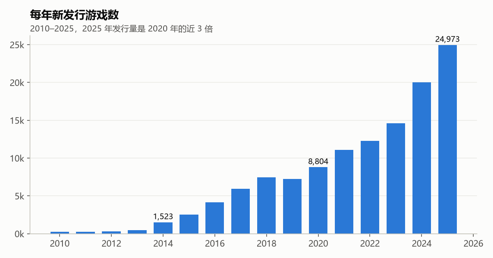
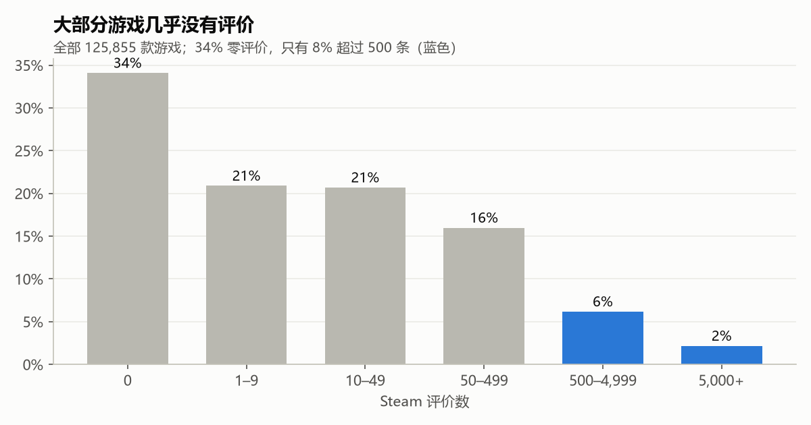
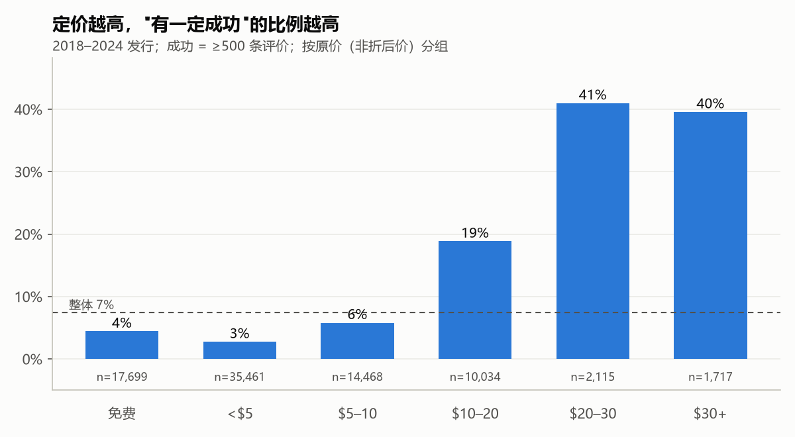
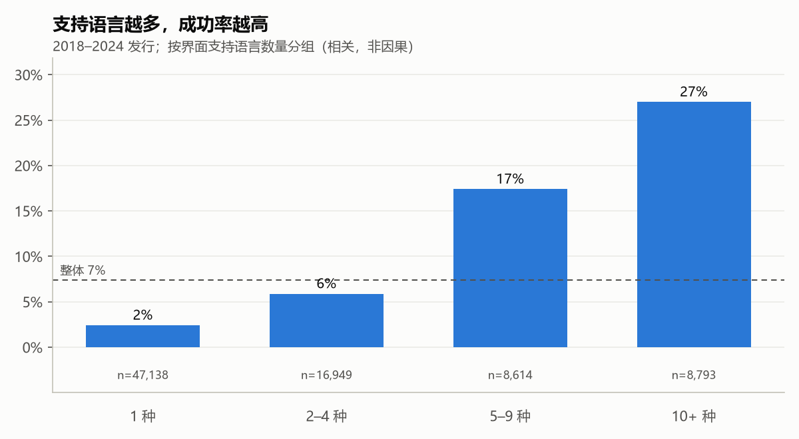
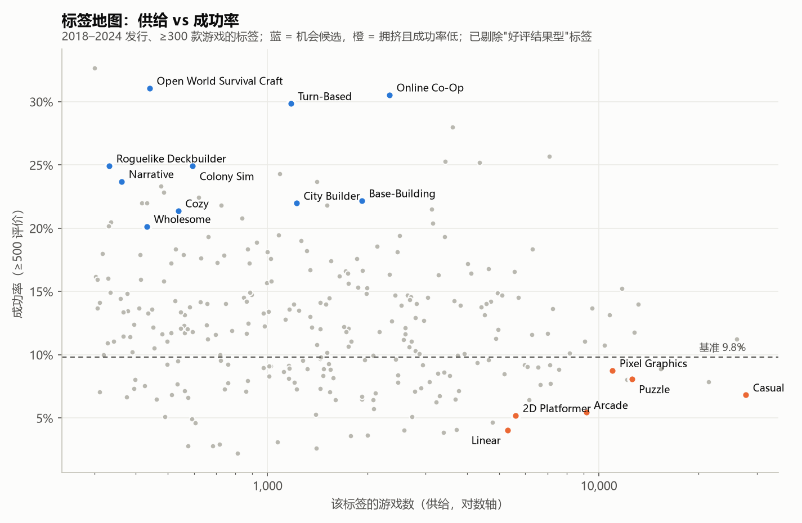

# Steam 游戏数据集：探索性分析（第一轮）

> 交互版展示见 [steam_tag_dashboard.html](steam_tag_dashboard.html)：一张主图（标签地图），悬停或点击标签后，附图联动切换。本文档保留静态版本的分析过程。

**数据**：FronkonGames/steam-games-dataset，`games.csv`，125,855 款游戏（去重后），数据截止约 2026 年 3 月。
**成功的定义**：Steam 评价数 ≥ 500 条（粗略对应数万份销量）。好评率只在评价数 ≥ 10（标签分析中 ≥ 20）的游戏里计算。
**时间窗口**：趋势用 2010–2025 年；成功率分析用 **2018–2024** 年发行的游戏。2025 年的游戏还没来得及积累评价，所以不算进去。

---

## 1. 全局基准线

| 指标 | 数值 |
|---|---|
| 零评价游戏占比 | **34%** |
| 评价数 < 50 的游戏占比 | **76%** |
| 评价数 ≥ 500 的游戏占比 | **8%** |
| 评价数最多的 1% 游戏拿走的评价份额 | **80%** |
| 中位好评率（评价数 ≥ 10） | 81% |
| 2018–2024 发行游戏的整体成功率 | 7% |

**结论**：Steam 上新游戏的供给在爆炸式增长：2020 年发行 8.8k 款，2025 年 25k 款。但每年达到 500 条评价的游戏数量一直稳定在 **800–950 款**左右。所以单款游戏的成功率从 2018 年的 11% 降到了 2024 年的 4.7%。蛋糕没怎么变大，分蛋糕的人多了三倍。

## 2. 定价

- 低于 $5 和免费的游戏占了一半以上，但成功率只有 3–4%。
- 原价 **$20 以上的游戏成功率约 40%**，是整体的 5 倍以上。
- 好评率反而在 $5–20 区间最高（约 84–85%），$30 以上掉到 80%。贵的游戏玩家期望也更高。
- ⚠️ 这是**相关，不是因果**：敢定价 $20+ 的往往是投入更大、质量更高的团队。正确的读法是"低价不能弥补质量"，而不是"涨价就能成功"。
- 注意：数据里的 `Price` 是抓取当天的**折后价**，这里已经按 `Discount` 换算回原价。

## 3. 本地化与功能

2018–2024 发行的付费游戏中，有某个特征的游戏和没有的相比，成功率分别是：

| 特征 | 有 | 没有 |
|---|---|---|
| 支持中文 | **15.6%** | 2.5% |
| Steam 成就 | 10.4% | 2.2% |
| 多人模式 | 14.1% | 5.6% |
| 手柄支持 | 11.7% | 3.9% |
| Mac 版 | 10.6% | 6.1% |

支持中文的游戏比例从 2015 年的 13% 升到 2025 年的 32%。这些特征同样主要反映**团队投入程度**，可以当作"专业度代理指标"，不能理解为"加上就能成功"。

## 4. 标签地图：哪里拥挤，哪里有机会

方法：取 2018–2024 发行、有标签的游戏（61,539 款，基准成功率 9.8%），只看至少 300 款游戏用过的标签（309 个）。完整表格见 [tag_stats.csv](tag_stats.csv)。

**高成功率、供给中等**（蓝点）：
| 标签 | 游戏数 | 成功率 | 中位好评率 | 2022 年后发行的占比 |
|---|---|---|---|---|
| Online Co-Op | 2,335 | 30.5% | 78% | 62% |
| Open World Survival Craft | 441 | 31.1% | 71% | 47% |
| Turn-Based | 1,176 | 29.8% | 82% | 31% |
| Roguelike Deckbuilder | 333 | 24.9% | 85% | **78%** |
| Colony Sim | 594 | 24.9% | 79% | 65% |
| Narrative | 363 | 23.7% | 90% | 66% |
| Cozy | 538 | 21.4% | **93%** | **86%** |
| Wholesome | 432 | 20.1% | 93% | 82% |

**拥挤、成功率低**（橙点）：Casual（27.8k 款，6.8%）、Arcade（5.4%）、2D Platformer（5.2%）、Linear（4.1%）、Puzzle、Pixel Graphics。
一个有意思的现象：**2D Platformer 和 Puzzle 的好评率很高（87–89%），但成功率很低**。游戏本身不差，问题在于供给太多、需求不够，玩家注意力被摊薄了。

**多人/合作和"系统驱动"类玩法**（生存建造、殖民模拟、城市建造、回合策略）成功率普遍较高。这类游戏可重玩性强、适合直播传播，容易积累评价。
**Cozy / Wholesome / Roguelike Deckbuilder** 是近几年新兴、口碑极好、还在快速增长的细分品类。

### 标签分析的陷阱（务必注意）
1. **结果型标签**：像 "Great Soundtrack""Classic""Masterpiece""Moddable" 这类标签，是玩家**在游戏成功之后**才打上去的，属于因果倒置，图里已经剔除。
2. **标签本身有幸存者偏差**：37% 的游戏没有任何标签。越热门的游戏，玩家打的标签越多（最多 20 个），所以细分标签天然更容易出现在热门游戏上，成功率会被高估。比较标签时，看相对排序比看绝对值更可靠。
3. 成人向标签（Hentai、NSFW 等）成功率也偏高，这里没有展开分析。

---

## 下一步建议

1. **选 1–2 个品类深挖**。根据上面的结果，比较好的候选有：
   - **Cozy / Wholesome**：增长快、口碑最好，问题是供给增长有多快、是不是即将饱和。
   - **Roguelike Deckbuilder**：78% 是近三年发行的，可以看头部集中度，以及定价和好评率的关系。
   - **Colony Sim / 生存建造**：成功率高，但开发成本也高。可以看 Early Access 的比例和表现。
2. 在选定品类里做**控制变量的对比**：同年份、同价格段的游戏之间，比较中文支持、成就、截图数量的影响。也可以用逻辑回归建模，估计每个因素在控制其他因素后的独立作用。
3. 用 `About the game` 文本做主题建模，或者用标签组合（比如 "Cozy + Farming" 和 "Cozy + Puzzle"）找更细的细分品类。
